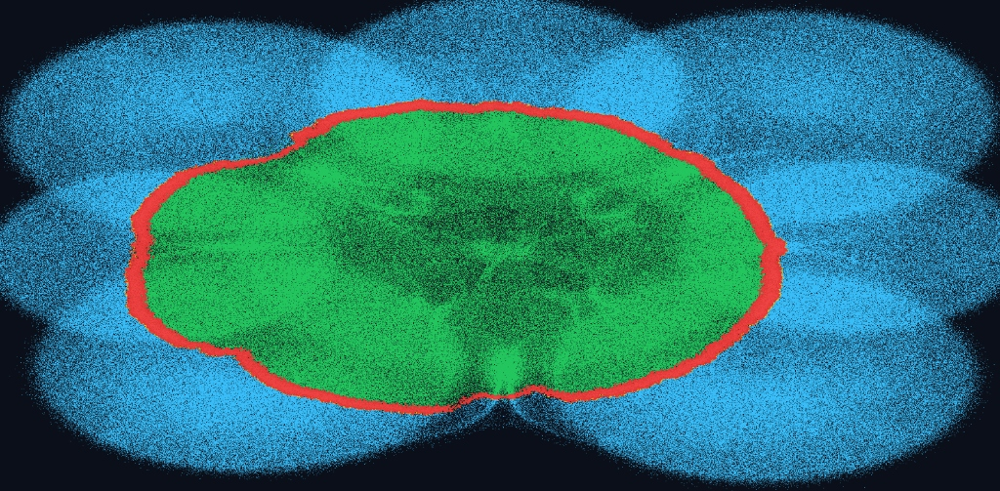
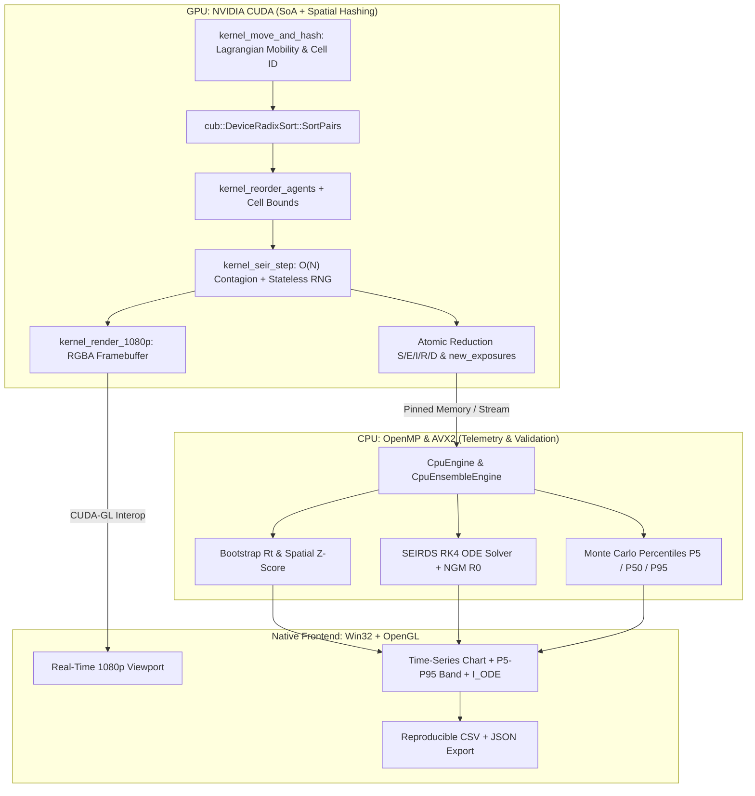

<div align="center">

# Miasma HPC Engine

[](https://isocpp.org/)
[](https://developer.nvidia.com/cuda-toolkit)
[](https://www.openmp.org/)
[](https://cmake.org/)
[](https://www.opengl.org/)

**Stochastic ABM SEIRD simulator in C++17 (OpenMP/AVX2) and NVIDIA CUDA (spatial hashing, urban mobility, Monte Carlo ensembles) with RK4/NGM validation, ABC-SMC calibration, and native 1080p Win32/OpenGL visualization.**

[Features](#features) • [Architecture](#hybrid-processing-architecture) • [Metrics & Benchmarks](#performance-metrics--benchmarks) • [Structure](#repository-structure) • [Requirements](#system-requirements--dependencies) • [Quickstart](#quickstart) • [Tests](#validation--test-suite) • [Documentation](#documentation--theoretical-framework)



</div>

---

## Features

* **Continuous 2D Stochastic ABM SEIRD Model:** Compartmental dynamics for Susceptible (`S`), Exposed (`E`), Infected (`I`), Recovered (`R`), and Deceased (`D`) states on a *Structure of Arrays* (SoA) layout with risk groups (`RiskGroup`), superspreading (`FLAG_SUPERSPREADER`), Lagrangian mobility (8 organic hubs), typed urban zones (`UrbanZone` monocentric/polycentric presets, family households, day/night & weekday/weekend cycles), contagion-source attribution, vaccination, waning immunity, hospital saturation, and targeted interventions (Z-score quarantine, school/work closure, household isolation).
* **Massively Parallel GPU Acceleration (NVIDIA CUDA):** $O(N)$ contagion evaluation via uniform-grid *Spatial Hashing* with `cub::DeviceRadixSort::SortPairs`, stateless RNG (`rand_u01`), physical agent reordering in VRAM, empty-infected cell skipping, and dynamic domain scaling based on available VRAM (`cudaMemGetInfo`).
* **Multi-Replica Monte Carlo Ensembles:** Single-launch parallel execution on GPU (`K = 1..32` replicas) with OpenMP CPU reduction (`CpuEnsembleEngine`) to compute percentiles (`P5`, `P50`, `P95`), epidemic probability $\mathbb{P}(R_t > 1)$ (CDC CFA decision categories), and extinction rate.
* **Telemetry, Calibration & Analytical Validation (CPU + OpenMP + AVX2):** Deterministic SEIRDS ODE solver (RK4), $R_0$ via 2D kinetic Next-Generation Matrix (NGM), spatial outbreak *Z-score* detection, real-time *bootstrap* $R_t$ estimation, **ABC-SMC** stochastic calibration (`calibrate_abc_smc`), probabilistic forecast scoring (**WIS**, **IS80**, **RMSE**, **MAE**), and global sensitivity sweeps.
* **Native Visualization & Reproducible Export:** Win32 + OpenGL interface decoupled from the CUDA worker thread with a 1080p ($1920 \times 1080$) RGBA framebuffer, real-time interactive controls, time-series charting (P5–P95 confidence band and `I_ODE` reference curve), and reproducible CSV/JSON export to `reports/`.

---

## Hybrid Processing Architecture



---

## Performance Metrics & Benchmarks

Measured on **NVIDIA GeForce RTX 5050 Laptop GPU** (Blackwell `SM 12.0`, 8 GB VRAM, CUDA 13.5, MSVC 19.44, `/O2 /arch:AVX2`).

### 1. GPU Throughput & 1080p Rendering Scaling

| Agents ($N$) | Simulation Step (ms/step) | 1080p Render (ms) | Throughput (M agents/s) | VRAM Used (MB) |
| ---: | ---: | ---: | ---: | ---: |
| `100,000` | `0.167` | `0.183` | `597.96` | `1,109` |
| `250,000` | `0.152` | `0.197` | `1,644.25` | `1,121` |
| `500,000` | `0.319` | `0.203` | `1,568.31` | `1,143` |
| `1,000,000` | `0.809` | `0.217` | `1,235.88` | `1,185` |
| `2,500,000` | `2.010` | `0.302` | `1,243.86` | `1,335` |

### 2. Sample 30-Day Simulation Output (CSV Telemetry)

A 30-day headless run (`N = 250,000` agents, `I0 = 150`, `dt = 1/24` day, `720` steps) completed in **`129.89 ms` total (`0.180 ms/step`)**, reaching a peak of **`213,828` active infected** and conserving population exactly ($S + E + I + R + D = 250{,}000$). Full time-series export: [`reports/miasma_benchmark_sim.csv`](reports/miasma_benchmark_sim.csv).

### 3. Scientific Benchmark Highlights (`miasma_scientific_benchmarks.exe`)

* **Analytical Thresholds (Kermack–McKendrick):** RK4 ODE final attack rate matches analytical theory within `1.44e-05` at $R_0 = 2.5$ and `4.54e-09` at $R_0 = 10.0$.
* **1918 Flu NPIs (Markel et al. 2007):** Sustained NPIs reduced GPU ABM peak infection by **`-92.6%`** (`27.52%` → `2.04%`) and mortality by **`-90.4%`** (`4.12%` → `0.40%`).
* **Stochastic Extinction ($R_0 > 1, K = 32, I_0 = 3$):** `53.1%` early extinction in homogeneous mixing vs. `78.1%` with `10%` superspreaders (`6x`).
* **Urban Topology (`N = 20,000`):** Monocentric city peaked at `46.91%` (day `29.0`) vs. polycentric at `39.43%` (day `33.0`).
* **ABC-SMC Practical Identifiability:** Joint 3-parameter calibration `(beta, E, I)` tightened credible interval width from `0.450` to `0.261` and reduced `WIS` from `0.0213` to `0.0050`.

---

## Repository Structure

* `include/`: C++17 / CUDA headers (`types.hpp`, `cuda_engine.cuh`, `cpu_engine.hpp`).
* `src/`: CUDA/OpenMP engine implementations and native Win32/OpenGL UI (`cuda_engine.cu`, `cpu_engine.cpp`, `main.cpp`).
* `tests/`: Automated invariant suite (`test_invariants.cpp`) and scientific validation benchmarks (`test_scientific_benchmarks.cpp`).
* `docs/`: Technical documentation (`ARCHITECTURE.md`, `API_REFERENCE.md`, `USER_GUIDE.md`), architecture plan (`PROJECT_PLAN.md`), theoretical framework (`MARCO_TEORICO.md`), and bibliography (`referencias.bib`).
* `web/`: Auxiliary web resources (`index.html`, `app.js`, `style.css`).
* `CMakeLists.txt` & `build.bat`: CMake ($\ge 3.20$) build configuration and quick Windows build script (MSVC + `nvcc`).

---

## System Requirements & Dependencies

### 1. Minimum Recommended Hardware
* **CPU:** Multi-core x86_64 processor with **AVX2** instruction support.
* **GPU:** CUDA-capable **NVIDIA** graphics card (configured by default for Blackwell `sm_120`, adjustable via `CMAKE_CUDA_ARCHITECTURES`).
* **RAM / VRAM:** 8 GB system memory and a dedicated GPU with OpenGL + CUDA support.

### 2. Build Toolchain (C++ & CUDA)
* **Operating System:** Windows (for the native Win32 + OpenGL executable).
* **C++ Compiler:** **Microsoft Visual C++ (MSVC)** (Visual Studio 2022 / Build Tools) with **C++17**, `/arch:AVX2`, and `/openmp` support.
* **NVIDIA CUDA Toolkit:** Version **13.x** (`nvcc`, `cudart`, `curand`, and `CUB`).
* **CMake:** Version **3.20 or higher**.
* **System Libraries (Windows):** `opengl32`, `user32`, `gdi32`, `comctl32`.

---

## Quickstart

### 1. Clone the repository
```bash
git clone https://github.com/bytoledo/miasma.git
cd miasma
```

### 2. Build the project

#### Option A: CMake (builds `miasma_core`, `miasma_parallel.exe`, `miasma_tests.exe`, and `miasma_scientific_benchmarks.exe`)
```powershell
cmake -B build -DCMAKE_BUILD_TYPE=Release
cmake --build build --config Release
```

If your GPU uses a CUDA architecture other than `sm_120` (for example, Ada `89` or Ampere `86`):
```powershell
cmake -B build -DCMAKE_BUILD_TYPE=Release -DCMAKE_CUDA_ARCHITECTURES=89
cmake --build build --config Release
```

#### Option B: Direct Windows build script (`build.bat`)
```bat
build.bat
```

### 3. Run the simulation
```powershell
.\build\miasma_parallel.exe
```

From the interactive sidebar, you can adjust the mobility/quarantine factor, transmission rate ($\beta$), fatality rate, contagion radius, substeps per frame, initial cases, toggle interventions (targeted quarantine / vaccination), and export reproducible time-series reports to `reports/`.

---

## Validation & Test Suite

The repository includes an automated suite of **12 physical, numerical, and epidemiological invariant tests** in [`tests/test_invariants.cpp`](tests/test_invariants.cpp) and **8 scientific validation benchmarks** in [`tests/test_scientific_benchmarks.cpp`](tests/test_scientific_benchmarks.cpp):

```powershell
.\build\miasma_tests.exe
.\build\miasma_scientific_benchmarks.exe
```

Verified invariant tests (`12/12` passing):
* Dynamic VRAM hardware limits and domain scaling (`89 bytes/agent`).
* Exact population conservation ($S + E + I + R + D = N$) and telemetry.
* Deterministic reproducibility with stateless RNG.
* Conservation under Phase 2 interventions and exact incidence under vaccination.
* RK4 ODE solver and Next-Generation Matrix (NGM) $R_0$ validation.
* ABM convergence toward the analytical model in the high-diffusion regime.
* Lagrangian mobility, superspreaders, and Monte Carlo ensembles (`K = 8`).
* Urban layout & family flow attribution (`H`, `W`, `Tr`, `Hp`, `L`).
* Probabilistic forecast scoring (`WIS`, `IS80`) and global sensitivity sweep.
* ABC-SMC parameter calibration (`beta`, `E`, `I`).

---

## Documentation & Theoretical Framework

* **Technical Architecture (GPU SoA, CUDA Pipeline, OpenMP & UI):** [`docs/ARCHITECTURE.md`](docs/ARCHITECTURE.md)
* **C++17 / CUDA API Reference:** [`docs/API_REFERENCE.md`](docs/API_REFERENCE.md)
* **User & Developer Guide (Build, Controls, Exports & Tests):** [`docs/USER_GUIDE.md`](docs/USER_GUIDE.md)
* **Architecture Plan & Technical Log:** [`docs/PROJECT_PLAN.md`](docs/PROJECT_PLAN.md)
* **Theoretical Framework & Mathematical Formulation:** [`docs/MARCO_TEORICO.md`](docs/MARCO_TEORICO.md)
* **Bibliography (BibTeX):** [`docs/referencias.bib`](docs/referencias.bib)
