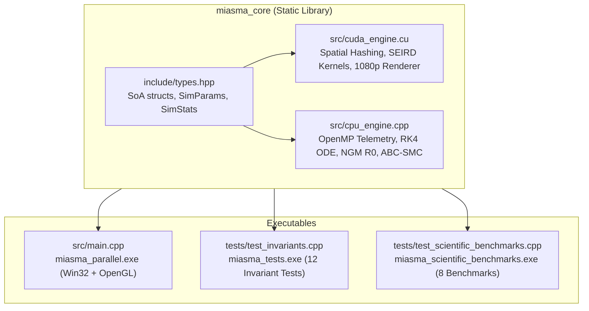
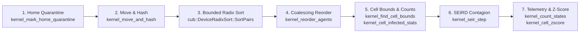

# Technical Architecture — Miasma HPC Engine

This document describes the internal software and hardware architecture of **Miasma HPC Engine** (`seird-Parallel`), covering the GPU data layout, CUDA simulation pipeline, CPU/OpenMP analytical engines, and the decoupled Win32 + OpenGL visualization frontend.

> For the mathematical and epidemiological derivations behind the model, see [`MARCO_TEORICO.md`](MARCO_TEORICO.md) and [`referencias.bib`](referencias.bib). For the C++/CUDA API signatures, see [`API_REFERENCE.md`](API_REFERENCE.md).

---

## 1. System Overview

Miasma is structured as a hybrid **GPU-CPU** simulation engine backed by a static core library (`miasma_core`) and consumed by the native GUI executable (`miasma_parallel.exe`), the invariant test suite (`miasma_tests.exe`), and the scientific benchmark suite (`miasma_scientific_benchmarks.exe`).

### Design Principles
1. **Structure of Arrays (SoA) in VRAM:** All agent attributes are stored in contiguous, aligned device arrays (`AgentSystemDevice`) rather than an Array of Structures (AoS), maximizing memory coalescing across CUDA warps.
2. **$O(N)$ Spatial Hashing:** Pairwise contagion checks are bounded to a $3 \times 3$ Moore neighborhood of grid cells sorted via `cub::DeviceRadixSort::SortPairs`, eliminating $O(N^2)$ scaling.
3. **Stateless RNG:** Deterministic per-agent, per-step pseudo-random numbers are generated via `rand_u01(seed, step, id, seq)`, removing `curandState` memory bandwidth overhead during the inner contagion loop.
4. **Decoupled Worker & UI Threads:** In `miasma_parallel.exe`, the CUDA simulation runs on a dedicated worker thread synchronized with the Win32/OpenGL render loop via mutexes and double-buffered framebuffers, preventing UI stalls.

---

## 2. Memory Architecture & Dynamic Hardware Scaling

### 2.1 Structure of Arrays (`AgentSystemDevice`)
Defined in [`include/types.hpp`](../include/types.hpp), `AgentSystemDevice` holds device pointers for `num_agents = agents_per_replica * num_replicas`:

| Category | Fields | Type | Purpose |
| :--- | :--- | :--- | :--- |
| **Kinematics** | `x`, `y`, `vx`, `vy` | `float*` | Continuous 2D position and velocity (world units / day) |
| **SEIRD State** | `state`, `state_timer` | `uint8_t*`, `float*` | Compartment (`S..D`) and remaining timer in `E`/`I`/`R` |
| **Stratification** | `risk_group`, `home_zone`, `rep_id` | `uint8_t*` | Bit-packed risk + superspreader flag; hub/activity; replica index |
| **Urban & Family** | `home_id`, `work_zone`, `infection_source`, `infection_flash` | `uint32_t*`, `uint8_t*`, `float*` | Family ID (2–5 agents), daytime district, contagion attribution, UI flash |
| **Spatial Hashing** | `cell_id`, `agent_idx`, `cell_start`, `cell_end` | `uint32_t*`, `int*` | Grid cell key, original index, per-cell slice `[cell_start, cell_end)` |
| **Rendering** | `framebuffer_rgba` | `uint8_t*` | 1080p (`1920 * 1080 * 4` bytes) RGBA framebuffer in VRAM |

### 2.2 Bit-Packing & Ping-Pong Buffers
To minimize VRAM footprint and memory traffic:
* `risk_group` packs the `RiskGroup` enum (`RISK_LOW`, `RISK_MEDIUM`, `RISK_HIGH`) in bits `0..1` (`RISK_GROUP_MASK = 0x03u`) and the superspreader flag in bit `7` (`FLAG_SUPERSPREADER = 0x80u`).
* `home_zone` packs the residential hub (`0..7`) in bits `0..3` and the daytime activity hub (`0..7`) in bits `4..7`.
* **Physical Reordering:** After `cub::DeviceRadixSort::SortPairs` sorts `agent_idx` by `cell_id`, `kernel_reorder_agents` physically permutes all agent arrays into ping-pong alternate buffers (`g_d_x_alt`, `g_d_y_alt`, etc.) and swaps pointers. Subsequent spatial reads in `kernel_seir_step` are therefore spatially coalesced in L1/L2 cache.

### 2.3 Dynamic VRAM Limits & Domain Scaling
Before allocating simulation buffers, `cuda_query_hardware_limits(reserve_vram_mb)` queries `cudaMemGetInfo`:
* **Per-Agent Footprint:** Accounts for ping-pong SoA arrays (`2 * (6 * float + 6 * uint8_t + 3 * uint32_t)`), household quarantine flags (`1 B`), and CUB sort temporary margin (`4 B`).
* **Fixed Overhead:** Reserves space for the 1080p framebuffers (`FRAME_WIDTH * FRAME_HEIGHT * (4 + sizeof(uint32_t))`), `32 MB` for grid/context metadata, and `reserve_vram_mb` (default `1024 MB`).
* **WDDM Safe Cap:** On Windows, `safe_agents_limit` is clamped between `100,000` and `20,000,000` to prevent Windows Display Driver Model (WDDM) Timeout Detection and Recovery (TDR) when single kernels exceed 2 seconds.
* **Domain Scaling:** `cuda_adjust_domain_for_agents` sets `cell_size = max(4.0f, infection_radius + 0.5f)` and scales `world_width`/`world_height` by $\sqrt{N / 10^6}$ whenever $N > 1{,}000{,}000$, keeping cell occupancy bounded around ~15 agents/cell.

---

## 3. CUDA Per-Step Simulation Pipeline

Each call to `cuda_step_simulation` executes on a dedicated CUDA stream (`g_sim_stream`) in five stages:

1. **Household Quarantine (`kernel_mark_home_quarantine`):** When `enable_urban_layout && household_quarantine` is active, scans agents and marks `g_d_home_quarantine[home_id] = 1` if any family member is in `STATE_I`.
2. **Lagrangian Mobility & Hashing (`kernel_move_and_hash`):**
   * Updates `(x, y)` and `(vx, vy)` according to `dt`, `base_speed`, `quarantine_factor`, `RiskGroup` mobility modifiers, focal cell quarantine (`g_d_cell_quarantine`), and either organic urban clustering (8 hubs in `__constant__` memory `kHubX`, `kHubY`, `kHubR`) or typed `UrbanZone` daytime/nighttime/weekend schedules.
   * Deceased agents (`STATE_D`) remain stationary.
   * Computes global `cell_id = rep_id * num_cells + local_cell_y * grid_w + local_cell_x` and resets `agent_idx[i] = i`.
3. **Bounded-Bit Radix Sort (`cub::DeviceRadixSort::SortPairs`):** Computes the exact minimum `sort_end_bit` covering `total_cells = num_cells * num_replicas` so CUB skips unused upper key bits.
4. **Physical Reorder (`kernel_reorder_agents`):** Permutes all 13 agent SoA arrays into cell-sorted order and swaps device pointers.
5. **Cell Bounds & Infected Pre-Scan (`kernel_find_cell_bounds`, `kernel_cell_infected_stats`):**
   * Identifies `[cell_start[c], cell_end[c])` for every occupied cell.
   * Counts infected agents (`STATE_I`) per cell into `g_d_cell_infected[c]`.
6. **SEIRD Transitions & $O(N)$ Contagion (`kernel_seir_step`):**
   * **Empty-Cell Skipping:** Susceptible agents (`STATE_S`) inspect their own cell and the 8 neighboring cells (within the same replica). Any neighbor cell with `g_d_cell_infected[nc] == 0` is skipped immediately.
   * **Contagion:** For each infected neighbor within `infection_radius`, applies `beta` scaled by superspreader multiplier (`superspreader_mult` if `FLAG_SUPERSPREADER` is set) and records `infection_source` (`SRC_HOME`, `SRC_WORK`, `SRC_TRANSIT`, `SRC_HOSPITAL`, `SRC_LEISURE`) plus `infection_flash` for UI highlighting.
   * **Compartmental Transitions:** Updates `E -> I` (`incubation_days`), `I -> R/D` (`infectious_days`, `fatality_rate` modulated by `RiskGroup` and hospital saturation `hospital_capacity_pct`), vaccination (`S -> R` via `vaccination_rate`), and waning immunity (`R -> S` via `immunity_days`).
   * Atomically increments `new_exposures` per replica in `g_d_counts`.
7. **Telemetry Reduction & Spatial Z-Score (`kernel_count_states`, `kernel_cell_infected_stats`, `kernel_cell_zscore`):**
   * Counts `S`, `E`, `I`, `R`, `D`, `infection_source` totals, and `hospitalized_count` per replica.
   * Computes mean and variance of infected agents per cell across replica 0, then flags anomalous cells ($Z > 2.0$) in `g_d_cell_quarantine` and outputs `hotspot_cells` and `max_cell_z` via pinned host memory (`g_h_counts_pinned`, `g_h_hotspot_pinned`).

### 3.1 Multi-Replica Monte Carlo Ensembles
When `num_replicas > 1` (`K <= MAX_REPLICAS = 64`), all $K$ replicas reside in the same `AgentSystemDevice` arrays, partitioned by `rep_id` and `cell_id` offset (`rep_id * num_cells`). A single kernel launch advances all replicas simultaneously without cross-replica contamination. In mosaic mode (`ensemble_grid_view == true`), `compute_mosaic_grid(K, cols, rows)` tiles the 1080p framebuffer into a `cols x rows` grid.

### 3.2 1080p GPU Rendering Pipeline
`cuda_render_1080p_device` composes the `1920 x 1080` RGBA framebuffer directly in VRAM:
* `kernel_prepare_framebuffer`: Clears or decays previous frame pixels (producing motion trails when `enable_trails == true`).
* `kernel_render_heatmap_1080p`: Bilinear thermal density map of infected cells and $Z > 2.0$ hotspots (used in `RENDER_HEATMAP` and `RENDER_HYBRID`).
* `kernel_render_urban_zones_1080p`: Draws district boundaries, labels/types, day/night ambient lighting, and selected family tracking overlays (`selected_home_id >= 0`).
* `kernel_render_agents_prio` + `kernel_composite_prio`: Renders agents with visual priority (`I > E > R > S > D`), contagion radius rings (`show_rings`), and new-infection flashes.

---

## 4. CPU / OpenMP Analytical & Calibration Engine

Implemented in [`src/cpu_engine.cpp`](../src/cpu_engine.cpp) and declared in [`include/cpu_engine.hpp`](../include/cpu_engine.hpp), all CPU analytics run in parallel using OpenMP and AVX2 (`/O2 /arch:AVX2`):

* **`CpuTelemetryEngine`:** Maintains a sliding window (`window_size`, default 64) of `SimStats` and exact daily incidence (`new_exposures`). Computes:
  * Instantaneous $R_t$ with OpenMP bootstrap resampling (`rt_p05`, `rt_p95`) and $\mathbb{P}(R_t > 1)$ mapped to CDC CFA categories (`RtCategory`: `RT_DECLINING` through `RT_GROWING`).
  * Structural $R_0$ (`compute_r0_ngm`) via the spectral radius of the $3 \times 3$ Next-Generation Matrix over `RiskGroup` strata using kinetic 2D transmission (`compute_abm_kinetic_beta`).
  * Spatial anomaly `z_score`, `outbreak_alert`, `cfr` ($D / (R + D)$), and `ifr` ($D / \text{cumulative infections}$).
* **Deterministic ODE Reference (`ode_seirds_simulate`):** 4th-order Runge-Kutta (`ode_seirds_step_rk4`) integrator for homogeneous SEIRDS dynamics, used both for live chart overlay (`I_ODE`) and analytical convergence verification.
* **`CpuEnsembleEngine`:** Aggregates per-replica `TelemetryMetrics` across $K$ Monte Carlo replicas in parallel using OpenMP to compute `i_p05`, `i_p10`, `i_p50`, `i_p90`, `i_p95`, `rt_p05`/`rt_p50`/`rt_p95`, `prob_rt_gt_1`, and `extinction_pct`.
* **Probabilistic Scoring & Sensitivity:**
  * `compute_ensemble_forecast_scores`: Computes `mae`, `rmse`, `is80` (80% Interval Score), `wis` (Weighted Interval Score), `coverage_80`, and `coverage_90`.
  * `run_global_sensitivity_sweep`: Parallel OpenMP parameter sweep over `(beta, quarantine_factor, superspreader_frac)`.
* **ABC-SMC Calibration (`calibrate_abc_smc`):** Sequential Monte Carlo Approximate Bayesian Computation over `(beta, incubation_days, infectious_days)` using parallel OpenMP particle evaluation against observed prevalence time series.

---

## 5. Native Win32 + OpenGL Frontend & Auxiliary Web Assets

In [`src/main.cpp`](../src/main.cpp):
* **Threading:** The Win32 message loop and OpenGL renderer run on the main thread (`g_gl_hwnd`), while `cuda_step_simulation` runs on a background worker thread.
* **Viewport & Overlays:** The 1080p CUDA framebuffer is uploaded as an OpenGL texture (`glTexSubImage2D`) onto the left viewport, with an overlaid real-time epidemic curve (SEIRD trajectories, `I_ODE` reference, and P5–P95 Monte Carlo confidence band) and HUD.
* **Sidebar:** A `SIDEBAR_W` native Win32 control panel on the right organized into 3 tabs (`Control & Ciudad`, `Parámetros`, `Vista & Export`).
* **Auxiliary `web/` Directory:** Contains static HTML/CSS/JS dashboard assets (`web/index.html`, `web/app.js`, `web/style.css`) alongside `include/httplib.h` from an earlier/auxiliary web-UI prototype; the primary production executable built by `CMakeLists.txt` and `build.bat` is the native Win32 + OpenGL application (`miasma_parallel.exe`).
